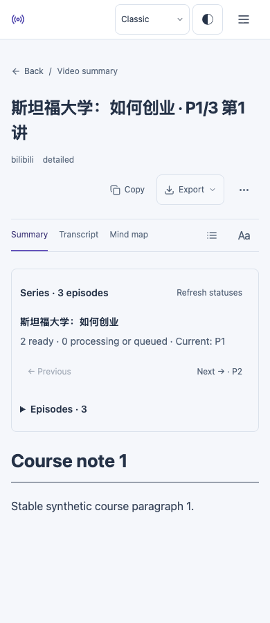
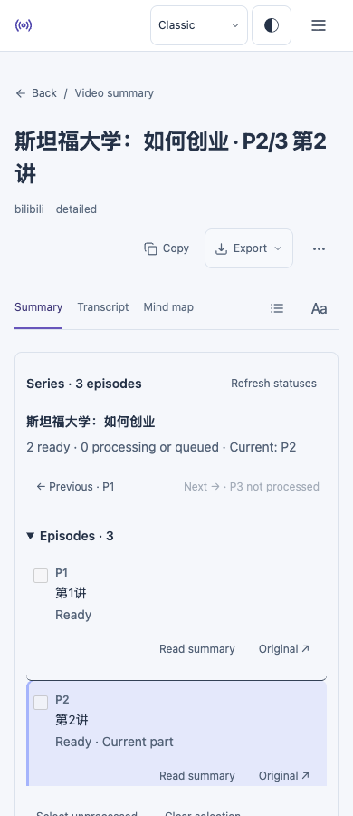

# 2026-11-14 网站巡检与修复

基线 main / 生产：`75b2daab56434a039f08888b7887be3a67171648`。北京时间 11 月 14 日执行。读取交接页、当前三份 UI/浏览器合同、Nov10/11/13 证据及 PR #239–#242/#252/#254；这些 PR 均已合并，未重新列为待修。未运行付费生成，未重启生产，未恢复用户暂停项。

## A 实际探索与图片查看

1. 当前生产构建的合成 series：Dashboard / Library → 稳定展开 → P1 阅读 → P2 → 刷新 → 返回原入口与查询。Classic/Editorial × light/dark × 390/820/1440px，共 24 条路径；逐张查看 24 张截图。等待分集状态实际完成，不接受加载中截图。当前/可读/未处理状态一致，无确认的溢出或裁切。局限：本地合成 API，不是生产账号数据或实体设备。
2. 确认阅读器目录默认收起，与 AGENTS.md 明确要求的默认展开不符。查看 [before screenshot](evidence/2026-11-14-handoff/directory-before.png) 后独立修复，PR #270。恢复 native details 的 open 默认；手动折叠可继续使用，刷新状态不强制展开。修复后 24 条合成路径与 12 项 multipart 浏览器回归通过。修复后人工查看四张代表性阅读器截图；其他修复后截图只归自动化证据。
3. 专用账号通过正常 UI 登录，受保护 Library、auth/me、stats 返回 200。现有 8 条笔记，5 个视频任务。现有 Bilibili 源的只读 collection API 返回 2 分集、1 条 ready；持久化任务没有合集元数据。因此不能把该账号说成已具有两个可互相切换的 saved 分集，不能把本地 series 断言改写成生产服务覆盖。
4. 当前提取器预检唯一 W3Schools 原文样本：0 音视频。通过普通 Dashboard UI 导入 `c0c49d04-cfa`，观察到 24.802 秒成功，original、model 为空，5080 字符。随后 DELETE 200、GET 404。未修改旧内容。后续主题阅读检查遇到冷启动超时，未接受为文章视觉/刷新验收；没有再次导入该样本。
5. 独立冷启动：一轮文档接收 HTTP200 后超过 60 秒未完成，仍显示现有重试壳；另一新会话约 13 秒正常到登录页。curl 未压缩文档 25 秒收到 669502 字节后超时；压缩请求 201780 字节约 7.95 秒完成，gzip 头存在。当前只能确认传输波动，未定位为应用代码缺陷。失败截图实际查看，未计为成功验收。另一次只读复测停在登录页的 Server connection timed out 提示，属于登录请求超时，不能混称文档启动超时；成功匿名登录页截图也已查看。没有降低 TLS/沙箱要求。

## B 自动化与诊断

- 基线前端 555 测试、生产构建通过。9 页面 × 4 外观 × 3 视口 = 108 项边界断言通过，未逐张人工查看，不称全面视觉验收。现有 appearance/control retained-state 回归通过。
- PR #269 新增两条旧任务的安全只读诊断；3 项范围、脱敏、歧义和时间戳测试通过。工作流 `43586673931` 在 `8abaf28d1518afe3c0a9235bf0bb69b91287e040` 上成功运行。
- 两条旧导入记录仍在：均 cancelled、deleted、cancel_requested，attempts=0，无保留租约；当前 drain 为空。**drain 返队会递减 attempts，所以这些快照不能证明从未领取。** 不把当前健康或新任务成功当作旧问题已修复。
- 旧记录时间：第一条 2026-11-11 01:58:29–01:59:40 UTC；第二条 02:00:53–02:04:28 UTC。Nov11 正常部署 02:33:34 UTC 才开始；Nov10 日期过滤未发现部署运行。仍缺当时 claim 结果、heartbeat、drain 区间和 dispatcher poll / slot occupancy。
- PR #270 前端 556 测试通过；最终聚焦目录测试 9 项通过。保持 197.75 KiB 预算，最终本地输出正好 202496 字节；未提高预算。合并相邻 var 声明仅减少重复启动字节。生产构建与文档启动回归通过，包含无外部 JS、流式导航、提前设置和框架前故障记录。
- 本机 Chrome 157；启用 Chromium sandbox 与证书校验。CI Chromium/WebKit、真实线上、合成夹具与实体设备分开记录。

## C 未完成条件

- 旧 pending 根因：本轮已检查的队列只保留快照，当前/上一容器通道没有当时任务级事件，不能据此回推。未证明全平台不存在另行归档的运行日志；若有 11 月 11 日归档，仍需其标识与查询通道。可用访问渠道已实际走通；缺失的是上述历史字段，而非笼统“没有浏览器”。下一自然复发需任务级时间线；本轮不以重启制造恢复。
- 真实上游524：本轮没有发起模型任务，未获得新的自然失败回执；旧证据不保留 HTTP 码。Nov10 本地 SQLite/合成供应商 524 验收仍有效，不能扩展为真实供应商验收。
- 生产同合集两个 saved 分集切换：现有源只保存 1 条 ready，缺第二条可读分集和持久化合集元数据；不为补表重复付费生成。修复上线后的生产前端夹具验收须单独标注。
- 密码重置/跨账号：仍缺第二专用账号、可控收件箱及隔离测试数据。实体 iPhone/iPad 未接入。Notion、独立托管环境和历史图片恢复继续暂停。

## 交付状态

- PR #269：完整 CI `43586646157` 通过，已合并 `44bb3e8bdf7968f49624321a27783c6e77b52017`；main 自动诊断 `43589297716` 通过，回读与分支相同。未触发应用部署。
- PR #270：完整 CI `43587791871` 通过，已合并并经现有部署 `43590562103` 发布 `c7cbb55fcfc8361b9613e900db9b9ce3712758ee`。独立健康接口为 ok，精确 SHA 一致；前端文件树与测试提交 `887ca3e` 完全一致。
- 私有凭证只经本机 mode600 临时文件进入进程，不纳入报告或仓库；浏览器进程结束后已删除临时凭证文件。原 main 副本已安全快进到发布 SHA。

## 发布后的 A/B/C 补充

**A 实际查看：** 默认传输的新会话正常登录一次成功，受保护 stats 200。实际生产前端采用浏览器内合成 Library/reader/collection GET 数据；Classic 深色 1440px、Classic 浅色 820px 两条完整路径通过：稳定 series 展开→P1→手动折叠/状态刷新保持折叠→键盘展开→P2→刷新默认展开→返回稳定 Library。两张截图实际查看，无横向溢出，零内容写入。新组件资源为 `BilibiliParts-DDKI7ThR.js`。这是线上前端夹具验收，不是生产持久化分集服务验收。

**B 实际服务只读核对：** 线上 Library 的 5 条视频与轻量 progress API 的 5 条完成状态逐条一致。精确发布健康通过；两个 PR 的完整 CI 均成功。没有新模型调用。

**C 未通过与限制：** 首次发布后会话在登录页静态启动壳超时，现有 Retry loading 后仍未完成。HTTP/1.1 比较连接 20 秒未返回，不计验收。后续默认会话完成上述两条 Classic 路径；其 Editorial 截图因未等异步换肤、实际仍为 Classic，已拒收，返回 Library 又停在懒组件 Loading episodes。修正脚本，仅补 Editorial 两项的新会话再次卡在登录页启动，未开始换肤断言。因此线上 Editorial 两项没有通过，不能用本地/CI 替代，失败截图均保留。需要可完整接收 `/login` 文档及所需资源的稳定浏览器会话；若继续定位，还需当次浏览器请求与边缘/源站可关联日志。当前不把传输原因归给某一侧，也不声称目录修复解决了传输问题。

本地与 CI 已覆盖四种外观；线上仅上述两个 Classic 组合通过。实体设备、第二账号/收件箱、生产两个已保存分集仍未具备。历史 pending 根因仍缺历史事件；新诊断只补查询能力，不宣称修复旧队列。

| Before: initial P1 | After: P2 reload |
| --- | --- |
|  |  |

These public images use synthetic data. Authenticated production screenshots remain private.

[Diagnostic PR #269](https://github.com/aaronsxzhao/xyz_transcript_download/pull/269) / [Reader PR #270](https://github.com/aaronsxzhao/xyz_transcript_download/pull/270) / [Release](https://github.com/aaronsxzhao/xyz_transcript_download/actions/runs/43590562103).
