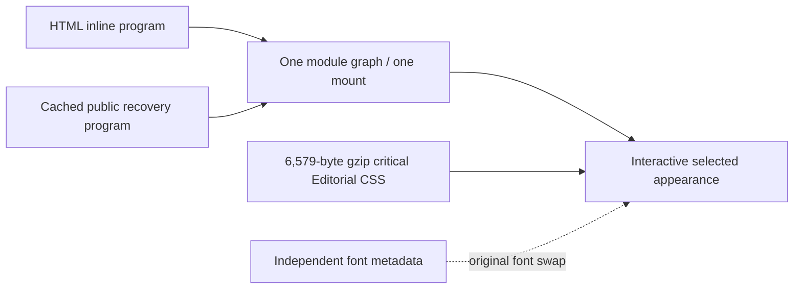

# Startup and Editorial release acceptance — 2026-11-15

Current deployed and independently verified revision: **`1c92f966e801fee7fd16ddea74af9460b792d586`**. This is a scoped release/acceptance record, not a promotion of every historical feature.

## Result

The application no longer has a single startup path behind the complete HTML tail. Editorial's critical theme no longer waits for the Unicode font manifest. Both fixes were merged and formally deployed. The new anonymous production Editorial matrix passes all six viewport/theme cases, and all six actual screenshots were inspected. Authenticated series/reader acceptance remains unperformed because the dedicated credential is unavailable.

| Work | PR | Merged revision | Full PR CI | Formal deployment |
| --- | --- | --- | --- | --- |
| Stalled document recovery and early selected skin preload | [272](https://github.com/aaronsxzhao/xyz_transcript_download/pull/272) | `1f33f3e8cd97c036680aa30c0a9afe454c607190` | [43622847598: success](https://github.com/aaronsxzhao/xyz_transcript_download/actions/runs/43622847598) | [43626099659: success](https://github.com/aaronsxzhao/xyz_transcript_download/actions/runs/43626099659) |
| Font metadata separated from the critical theme | [273](https://github.com/aaronsxzhao/xyz_transcript_download/pull/273) | `1c92f966e801fee7fd16ddea74af9460b792d586` | [43629076383: success](https://github.com/aaronsxzhao/xyz_transcript_download/actions/runs/43629076383) | [43631840868: success](https://github.com/aaronsxzhao/xyz_transcript_download/actions/runs/43631840868) |

Merged-version main CI: [43626099658](https://github.com/aaronsxzhao/xyz_transcript_download/actions/runs/43626099658) succeeded for #272. [43631840893](https://github.com/aaronsxzhao/xyz_transcript_download/actions/runs/43631840893) succeeded for #273, on the exact deployed revision.

#271 (`229b467`) was inspected and retained. Its diagnostic scripts/tests/evidence were not overwritten. The final merge contains that commit and #272.

## Confirmed causes and repair

The anonymous baseline received HTTP200 headers but could remain document-loading for 36–60+ seconds. The entire roughly 692kB decoded document carried the sole program entry at its tail. Fixed-codec experiments did not establish a compression-algorithm defect. The fix keeps the self-contained program and all page controllers, while one credential-free, content-hashed recovery request can install the identical graph after the existing 12s slow-start threshold. Either delivery path starts it once; failure preserves inline fallback; an inline win cancels recovery. The recovery fetch has a 15s abort. Healthy startup adds no program request.

The first deployed matrix was not accepted wholesale: 3/6 passed, both 820px cases showed Classic, and one 1440px dark reload remained on the startup shell. Those screenshots were actually inspected and preserved. A recovery response was observed as HTTP200/Brotli/MISS in 2.242s, and a form appeared before HTML completion; that did not establish complete themed acceptance.

The remaining selected skin was 142,686 raw / 42,720 gzip bytes because it included the font-face manifest. Font metadata could exceed the unchanged eight-second cosmetic timeout and cause Classic fallback. Early preload alone was insufficient. #273 keeps the same Noto Serif SC glyph files, ranges, weights and swap/fallback policy, but loads its metadata independently. Critical Editorial CSS is now 6,579 gzip bytes (85% less), and the document is 202,235 gzip bytes, below the unchanged 202,496-byte ceiling. No assertion, startup/style timeout, size budget or CI cap was raised.

No Cloudflare setting was changed. A supplementary fixed-gzip public curl experiment alternated normal and request no-transform headers. Both received identical 692,547-byte decoded documents with no injected beacon; totals were 4.56/1.71s and 1.55/2.90s respectively. This did not establish a stable benefit and was not used to justify an edge/header change. See [RFC9111](https://www.rfc-editor.org/rfc/rfc9111.html) for directive semantics. Exact packet-loss/ISP/edge responsibility is not established by these observations.

## Production acceptance on 1c92f96

Chrome 157.0.8103.52 on macOS, Chromium sandbox enabled, TLS verification retained, fresh browser contexts, service workers blocked, HTTP cache disabled by read-only routing. These are viewport checks, not physical phones/tablets. The endpoint health was HTTP200 with the exact revision; an independent Mac curl completed in 2.46s. A final fresh health request again returned the exact revision after all main CI jobs completed; fetched origin/main still points to that revision.

| Viewport | Editorial theme | Cold form usable | Reload form usable | Theme / input / checkbox / bounds | Public Chinese font delivery |
| --- | --- | --- | --- | --- | --- |
| 390px | light | 2.548s | 1.210s | pass | pass |
| 390px | dark | 2.257s | 2.252s | pass | pass |
| 820px | light | 2.502s | 1.774s | pass | pass |
| 820px | dark | 2.224s | 1.236s | pass | pass |
| 1440px | light | 3.519s | 1.745s | pass | pass |
| 1440px | dark | 4.093s | 2.483s | pass | pass |

All six cases have zero page errors, zero business writes and zero recovery-program requests on the healthy path. The declared selected theme and loaded core stylesheet were asserted on both initial load and reload. Each public font-delivery probe loaded the three matching Noto Serif SC faces for a fixed Chinese sample. This verifies public asset delivery; it is not a saved or authenticated Chinese reader claim. Latencies are six lab samples on this Mac, not a population p95 or a guaranteed speedup attribution.

All six viewport PNGs were actually inspected: correct warm neutral Editorial light/dark surfaces, rust/brown accents, serif text, complete form controls and no horizontal clipping. No blue/purple Classic fallback was accepted.

## Local and CI regression scope

- 83 frontend files / 556 tests pass. Public frontend/static-asset tests: 6 pass.
- Existing production-build startup, first paint, network resilience, offline public cache/update/rollback, page loading, optional asset boundaries, and the 12 Classic/Editorial × light/dark × 390/820/1440px series cases pass.
- Chromium and native macOS WebKit 27.2 pass the unclosed-script recovery, one-map/one-mount, HTTP503 fallback, in-flight cancellation and early skin cases. Linux CI WebKit is separate and passed in PR CI.
- New held-font regression: the baseline cannot open before the held manifest within the original 2.5s ceiling; the candidate is usable in 69ms / 115ms in the two engines. Typed input and checkbox state survive actual font application. A real synthetic HTTP503 is explicitly observed with cache disabled; Editorial remains usable.
- Actual custom Chinese glyph checks pass in both engines at 390/1440px and both themes; 13 used same-origin subsets, with Classic excluded. Font family declarations alone were not accepted as glyph proof.
- Supplementary controlled long-reader check: internal main scroller at 2,857px; after releasing the font metadata and loading the real face, visible-paragraph delta is 0px and scrollTop remains 2,857 in both engines. This is one local synthetic sample, not production/physical-device proof.
- WebKit intermediate streaming screenshots wait for document fonts/EOF and can change the fixture state. The artifact option skips those intermediate WebKit frames; all behavior assertions remain. Completed-document Editorial screenshots were actually inspected.

## Remaining external condition

Authenticated production series/reader acceptance requires the authorized dedicated test account through the private no-echo input channel or actual BROWSER_TEST runtime bindings. The previous temporary credential copy was deleted. This Mac currently has neither binding nor private input file; its existing Chrome profile showed an empty login form. The repository's exact BROWSER_TEST_EMAIL/PASSWORD secret names are absent as metadata; no secret value was read or exported. No token was fabricated, copied from another account or injected.

The authenticated harness is prepared for normal UI sign-in, real protected stats/state comparison, and scoped controlled front-end series/reader cases. It has not run. Anonymous, local-fixture and CI evidence above does not close that gap. A second dedicated account/mailbox, real two-saved-part service metadata and physical-device checks remain separate historical coverage gaps; no paid task was created to manufacture them.

No payment, import, subscription, deletion or model reprocessing was triggered in production. Closed paid validations were preserved and not repeated.

## Evidence locations

- [Startup diagnosis](2026-11-15-startup-transport.md), [font delivery diagnosis](2026-11-15-editorial-font-loading.md).
- Private original-checkout artifacts: `appearance-checks/cloud-browser/nov15-startup/live-anonymous/` (first PARTIAL run), `appearance-checks/cloud-browser/nov15-font-loading/live-anonymous/` (new PASS + visual-review.json), `appearance-checks/cloud-browser/nov15-font-loading/reader-position-v2/` (controlled late-font position probe).
- Earlier anonymous/local transport evidence remains at `appearance-checks/nov15-startup/`. No authenticated screenshot or raw session artifact is published here.
